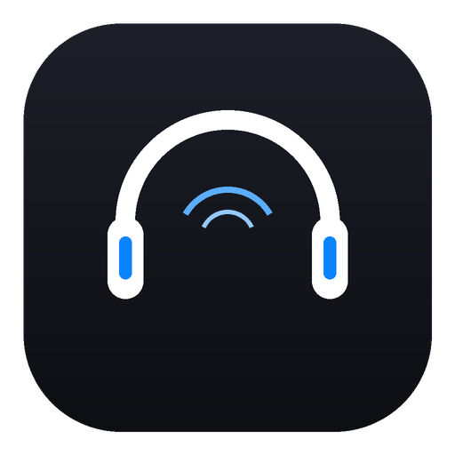
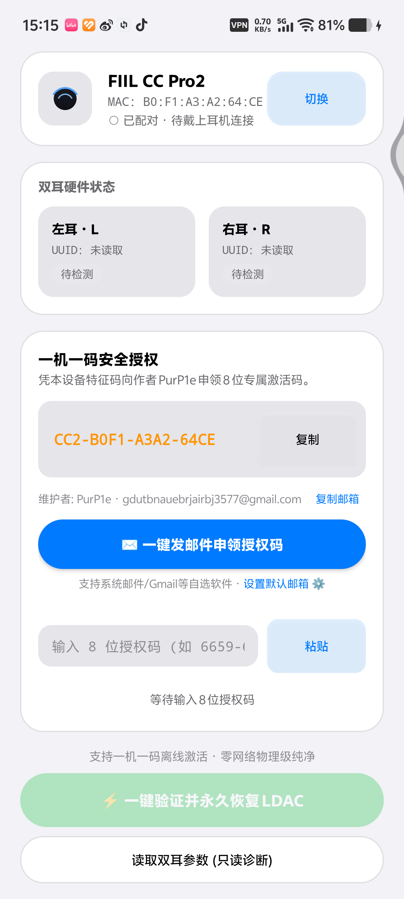
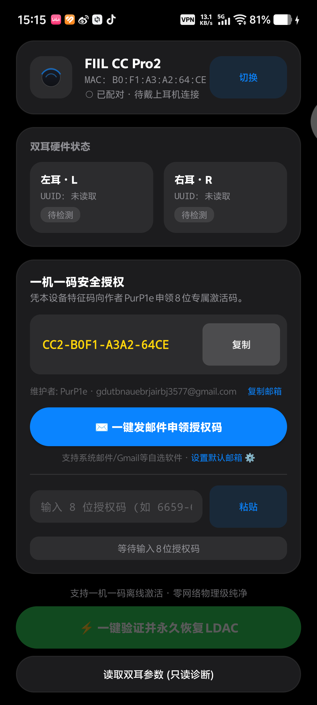

  

<h1 align="center">FIIL CC Pro2 (F039) LDAC 恢复与自救体系</h1>

  <strong>专为 FIIL 官方服务器关停后无法开启 LDAC 高清音频解码的受灾用户打造的纯净自救恢复方案</strong>

  
  
  
  
  

---

## 📖 项目背景 (Background)

**FIIL CC Pro2**（型号代码：`F039`）是具备旗舰级高解析度声学硬件的真无线降噪耳机，硬件原生支持 Sony LDAC (990kbps / 96kHz / 32bit) 高清音频解码。

然而，随着官方服务器关停与官方维护中断，大量受灾用户面临以下困境：
1. **云端认证通道失效**：官方服务器已无法连接，新设备或重置后的耳机无法获得在线激活授权；
2. **硬件高清解码受限**：耳机出厂默认锁定了高解析度音频解码通道，缺乏认证握手时将强制降级至普通编码；
3. **普通方案无法持久**：系统开发者选项或临时改机方案在更换设备或耳机重启后均会失效。

为捍卫硬件持有者的合法权益，本项目通过深入研究底层硬件通信机制，开发了这套**免注册、免账号、一机一码安全验证、硬件级永久固化**的自救恢复方案。

---

## ✨ 核心亮点 (Key Features)

- ☁️ **云端权威加密计算架构 (Cloud Cryptographic Authority)**  
  所有授权计算与鉴权校验统一由云端专属加密节点在线动态处理，客户端仅作为轻量透传终端，**物理级防范黑灰产反编译盗用与恶意倒卖**。
- 💎 **iOS 18 / Windows 11 Fluent 顶级质感设计**  
  摒弃粗糙杂乱色块，全面采用 Grouped Inset 大圆角卡片与现代流线视觉，**原生支持深色模式 (Dark) 与浅色模式 (Light) 随系统自动无感热切换**。
- ⚡ **硬件级永久固化 (Permanent Hardware Write)**  
  直接向耳机底层存储写入正向认证授权。激活一次，终身受益！无论重置耳机、更换 iPhone/Android 手机还是连接 Windows 电脑，LDAC 均保持常开。
- 🤖 **7×24h 全天候全自动秒回服务**  
  受灾用户在 App 内一键发送特征码至官方申领邮箱，云端部署的邮件服务节点将在数秒内全自动核发专属 8 位授权码。

---

## 📱 视觉预览 (Screenshots)

  
  &nbsp;&nbsp;&nbsp;&nbsp;&nbsp;&nbsp;&nbsp;&nbsp;
  

  <em>(左图：iOS 18 优雅浅色模式 | 右图：OLED 沉浸深色模式)</em>

---

## 🚀 受灾者三步快速恢复指南 (Quick Start)

### 第 1 步：安装客户端并识别耳机
1. 前往本仓库 [Releases 页面](../../releases) 下载 `FIIL_受灾者帮助器_ccpro2.apk` 并安装至手机；
2. 打开 App，确认顶部卡片已自动锁定您的耳机（例如 `FIIL CC Pro2 · MAC: B0:F1:A3:A2:64:CE`）；
3. 系统将自动生成属于您的唯一特征码（例如 `CC2-B0F1-A3A2-64CE`）。

### 第 2 步：一键发邮件申领授权码
1. 点击蓝色大胶囊按钮 **`✉️ 一键发邮件申领授权码`**；
2. 手机将自动打开系统默认邮件客户端（支持 Gmail、QQ 邮箱等），正文与收件人已自动填充完毕；
3. 发送邮件至维护者服务邮箱：`gdutbnauebrjairbj3577@gmail.com`；
4. 云端服务节点将在数秒内自动回复您的专属 8 位授权码（如 `6659-6180`）。

### 第 3 步：一键验证并永久固化
1. 从充电盒中取出耳机并戴入耳中，确认手机蓝牙已正常建立音频连接（App 顶部变绿显示通信就绪）；
2. 将收到的 8 位授权码填入 App 授权框中；
3. 点击底部绿色大胶囊按钮 **`⚡ 一键验证并永久恢复 LDAC`**；
4. **耐心等待 3~5 秒**：App 将自动与耳机建立安全信道，并通过云端节点完成底层硬件级授权固化写入；
5. **重连耳机生效（核心关键）**：提示“恢复成功”后，请**将耳机放回充电盒合盖 5 秒后重新戴上**（或在手机设置中关闭再打开蓝牙）。耳机重新握手建立音频连接后，即可永久畅享 Sony LDAC (990kbps) 旗舰音质！

---

## 🛡️ 安全合规与防护声明 (Security Statement)

为防止黑灰产商贩盗用本项目成果二次倒卖获利，保护受灾用户的合法权益，本项目实施了严格的安全保护：
1. **商业级代码保护与深度混淆**：客户端移除了所有调试符号与源文件信息，对业务逻辑进行了深度混淆，大幅拉高静态分析与逆向成本；
2. **防篡改与完整性自校验**：内置证书签名指纹与结构自校验机制，防止第三方二次篡改重打包；
3. **算法物理隔离**：核心授权算法与签名凭据 100% 托管于云端服务器，客户端不含任何离线生成逻辑，彻底阻断了制作收费外挂软件的技术路径。

---

## ⚖️ 法律合规与免责声明 (Legal & Fair Use Disclaimer)

> **请在下载或使用本项目产物前仔细阅读本声明：**
> 
> 1. **非官方性质声明**：本项目由个人开发者 `PurP1e` 独立发起与维护，属于独立第三方技术自救研究。本项目与 FIIL 品牌、北京斐耳科技有限公司及其任何关联实体**不存在任何商业合作、赞助、授权或从属关系**。“FIIL”、“CC Pro2”商标归原权利人所有，此处仅用于客观指示兼容设备型号。
> 2. **互操作性与自救合法性 (Fair Use & Interoperability)**：鉴于官方服务端已实质性终止服务、导致合法消费者所购硬件的核心功能无法正常运行，本项目旨在恢复受灾硬件的原生互操作性（Interoperability），符合相关司法管辖区关于硬件自救的法定合理使用精神。
> 3. **非商业纯公益声明**：本项目全线工具（客户端、云端服务）面向全体合法受灾用户**永久免费**提供，严禁任何个人或组织将本项目产物用于任何形式的商业收费、二次倒卖或捆绑销售。
> 4. **风险自负**：本工具写入的均为设备原生规范参数，但在极端异常情况下因外力断电导致的设备故障需由使用者自行承担。

---

## 📬 维护与联系 (Contact)

- **作者 / 维护者**：`PurP1e`
- **授权码申领与技术反馈邮箱**：`gdutbnauebrjairbj3577@gmail.com`
- **最新发布包下载**：请访问本项目 [Releases 页面](../../releases) 下载最新打包成品。

---

  <em>© 2026 PurP1e. All rights reserved. Built for FIIL CC Pro2 affected community.</em>

